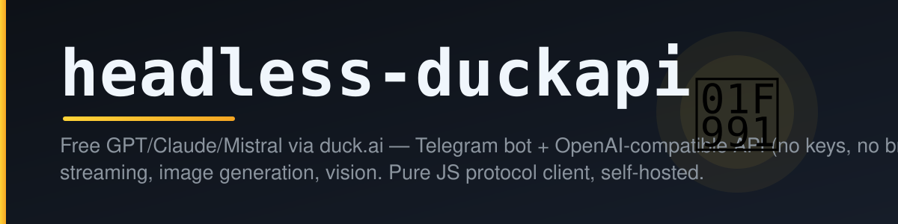

<p align="center"></p>

<h1 align="center">headless-duckapi</h1>

<p align="center"><b>Телеграм-бот и OpenAI-совместимый API на бесплатных моделях duck.ai.<br>
Живой стриминг · GPT / Claude / Mistral · генерация картинок · понимание фото · без API-ключей</b></p>

<p align="center">
  <a href="README.md">🇬🇧 English README</a>&nbsp;·&nbsp;
  <a href="serverless/README.md">☁️ Вариант для Telegram Serverless</a>&nbsp;·&nbsp;
  <a href="https://habr.com/ru/articles/1097568/">📖 Разбор протокола на Хабре</a>&nbsp;·&nbsp;
  <a href="LICENSE">MIT</a>
</p>

> **headless-duckapi** превращает чат [duck.ai](https://duck.ai) (тот самый бесплатный от DuckDuckGo — без API-ключей, без регистрации) в полноценного Telegram-бота. Внутри — **чисто JavaScript-реализация протокола duck.ai**, включая солвер антибот-челленджа, который исполняет обфусцированный JS в самодельном моке браузера. Никаких ключей OpenAI, никаких оплат.

> 📖 **Хочешь знать, как это работает под капотом?** На Хабре вышел большой разбор: [**«Headless-браузер без браузера: 5 408 байт»**](https://habr.com/ru/articles/1097568/) — реверс-инжиниринг антибот-защиты duck.ai, солвер челленджа x-vqd-hash-1 и самописный DOM-эмулятор, на котором стоит весь этот проект.

---

## Что умеет

| | |
|---|---|
| 💬 **Стриминг** | Ответ печатается в одно сообщение в живую, токен за токеном (аккуратный троттлинг правок, перенос длинных текстов) |
| 🤖 **Модели** | GPT-5.4 mini, GPT-6 Luna, Claude Haiku 4.5, Mistral Small, GPT-OSS 120B, Gemma 4… — список тянется живьём с duck.ai со статическим фоллбеком |
| 🎨 **`/img` — картинки** | Инструмент GenerateImage: сначала черновик-превью, потом финальная картинка как фото; дневная квота на пользователя |
| 📸 **Фото-vision** | Кидай фото (JPEG сам перекодируется в PNG) и спрашивай |
| 🌐 **Веб-поиск** | Инструмент WebSearch duck.ai, переключается на чат |
| 🧠 **Размышления** | none / low / medium, настраивается на чат |
| ⚙️ **Mini App** | Настройки в стиле Телеграма (модели, размышления, поиск, очистка истории) — бот раздаёт их сам |
| 📊 **/stats** | Пользователи, источники (в т.ч. реферальные ссылки и группы), активность по дням, топ моделей, здоровье протокола duck.ai |
| 💾 **Память** | История диалога на чат в SQLite, автоочистка |
| 🦆 **Антибот-стойкость** | Токены челленджа, версии фронтенда и решённые пруфы кэшируются в базе — бот как можно реже дёргает duck.ai и не ловит 418/429 |

**Команды:** `/start` `/help` `/img` `/models` `/model` `/effort` `/web` `/reset` `/settings` `/stats` — плюс постоянное меню-клавиатура. При первом старте бот сам настраивает описание, список команд, кнопку меню и аватарку.

## Архитектура

```
                        Telegram                       duck.ai
                 (Bot API, long polling)         (недокументированный API)
                          │                              │
                 ┌────────▼─────────┐          ┌─────────▼──────────┐
                 │      app.js      │          │ bot/lib/duckai.js  │
                 │  цикл polling    │          │  клиент протокола  │
                 │  HTTP (mini app) │          │  солвер челленджа  │
                 ├──────────────────┤          │  (чистый JS, 0 dep)│
                 │ bot/handlers/*   │◄────────►│  SSE-стриминг      │
                 │ облачный код,    │  'sdk'   └────────────────────┘
                 │ 2 помеченных     │  слой
                 │     патча        │  совмес-
                 ├──────────────────┤  тимости
                 │ platform/sdk/    │
                 │  api → Bot API   │
                 │  db  → SQLite    │
                 │  fetch → Node    │
                 └──────────────────┘
```

- **`bot/`** — сама логика бота. Один и тот же код работает **без изменений** и в облаке Telegram Serverless (см. [`serverless/`](serverless/README.md)), и на любом VPS; под VPS затронуты ровно две строки (помечены `[VPS port patch]`).
- **`platform/sdk/`** — тонкий слой совместимости, реализующий облачный модуль `sdk` для Node.js: `api` → Bot API по HTTPS (с multipart-загрузкой файлов), `db` → SQLite через встроенный `node:sqlite`, `fetch` → глобальный fetch. Именно поэтому один и тот же код живёт в обоих местах.
- **`web/`** — фронтенд Mini App. Он изначально умеет оба транспорта: `Serverless.call` платформы в облаке и обычный `POST /api/settings` с подписанным `initData` при самостоятельном хостинге.
- **`api.js`** — опциональный вход без Telegram: тот же клиент протокола `bot/lib/duckai.js` за OpenAI-совместимым HTTP-сервером (`/v1/chat/completions`, `/v1/models`, `/health`). Без `BOT_TOKEN` и БД — см. [OpenAI-совместимый API](#openai-совместимый-api-без-токен-бота).

## Быстрый старт (Docker)

```bash
git clone https://github.com/golaso024/headless-duckapi.git && cd headless-duckapi
cp .env.example .env          # впиши токен бота в .env
docker compose up -d --build
```

Готово — открой бота в Телеграме и напиши `/start`. Логи: `docker compose logs -f`.

Не хочешь клонировать и собирать? Есть готовый образ (собирается GitHub Actions на каждый тег `v*`):

```bash
# API-режим без токен-бота:
docker run -d -p 8081:8080 -e API_KEY=secret ghcr.io/golaso024/headless-duckapi:latest node api.js
# или бот:
docker run -d -e BOT_TOKEN=123:ABC ghcr.io/golaso024/headless-duckapi:latest
```

## Быстрый старт (нативно)

Node.js **≥ 22.5** (рекомендую 24 — SQLite встроена, поэтому `npm install` ставит ноль зависимостей):

```bash
git clone https://github.com/golaso024/headless-duckapi.git && cd headless-duckapi
npm install
cp .env.example .env          # впиши токен бота в .env
node app.js
```

Чтобы жил как сервис:

```bash
sudo cp systemd/duckai.service /etc/systemd/system/
# поправь User=/WorkingDirectory=/EnvironmentFile= под свою установку
sudo systemctl daemon-reload && sudo systemctl enable --now duckai
journalctl -u duckai -f
```

> Токен — в **@BotFather → твой бот → API Token**. Запускай либо эту копию, либо Serverless-копию на одном токене, но не обе сразу (при старте VPS-версия удаляет webhook — побеждает та, что запущена последней).

## OpenAI-совместимый API (без токен-бота)

С версии v1.1.0 тот же pure-JS протокол duck.ai наружу отдаёт ещё и **OpenAI-совместимый HTTP API** — ноль зависимостей от Telegram: не нужен ни `BOT_TOKEN`, ни `.env`, ни SQLite (токены челленджа кэшируются в памяти процесса). Тот же солвер, тот же стриминг, те же модели — просто `POST /v1/chat/completions`:

```bash
# Docker — только API:
docker compose --profile api up -d --build headless-duckapi-api
# → http://localhost:8081/v1/chat/completions

# Нативно:
node api.js                   # или: PORT=8080 API_KEY=secret node api.js
node api.js models            # вывести живой список моделей и выйти
```

Проверка:

```bash
curl http://localhost:8081/v1/chat/completions \
  -H 'content-type: application/json' \
  -d '{"model":"gpt-5.4-mini","messages":[{"role":"user","content":"Привет!"}],"stream":true}'
```

| Эндпоинт | Что делает |
|---|---|
| `GET /v1/models` | Живой список моделей с duck.ai (статический фолбэк, если duck.ai недоступен) |
| `POST /v1/chat/completions` | Chat completion, `stream: true/false` — SSE-чанки в формате OpenAI |
| `GET /health` | Проба живости (её же использует Docker healthcheck) |

Совместимость с OpenAI-клиентами (`baseURL = http://localhost:8081/v1`, `apiKey` — любой, если не задан `API_KEY`):

- устаревшие id моделей (`gpt-4o-mini`, `claude-3-haiku`, …) под капотом маппятся на ближайшую актуальную модель duck.ai — истина в `GET /v1/models`;
- `content` может быть массивом частей: `{type:"text"}` и `{type:"image_url"}` (data: или http(s)-URL; JPEG перекодируется в PNG на чистом JS — duck.ai JPEG-части не принимает);
- `role: "developer"` маппится в `system`;
- `temperature`, `max_tokens` и прочее принимается и игнорируется — у duck.ai таких ручек нет.

Расширения поверх схемы OpenAI, все опциональные:

| Поле | Что делает |
|---|---|
| `reasoning_effort: "none" / "low" / "medium"` | reasoning effort duck.ai (валидируется по модели — получишь внятный 400 вместо невнятного от duck.ai) |
| `web_search: true` | тул WebSearch duck.ai |
| `image: true` | тул GenerateImage duck.ai — в ответе появится `message.images: ["data:image/…;base64,…"]` (работает на GPT-моделях; дефолт `/img` у бота — `gpt-6-luna`) |

Задай `API_KEY` (в `.env` — compose подхватит сам — или в переменных окружения), чтобы требовать `Authorization: Bearer <API_KEY>`; пустое значение оставляй только в доверенной сети.

Несколько ключей сразу: `API_KEYS=k1,k2,k3` — у каждого свой бакет рейт-лимита (`RATE_LIMIT_RPM`, по умолчанию 30/мин; превышение вернёт HTTP 429 с `Retry-After`). Это способ делиться API, не давая одному клиенту сжечь общую квоту duck.ai.

## CLI в терминале (`cli.js`)

Третье лицо того же движка: интерактивный чат прямо в терминале. Те же модели, тот же стриминг, тот же солвер антибота — без Telegram и без HTTP-сервера:

```bash
node cli.js                       # модель по умолчанию
node cli.js --model haiku         # старт с другой моделью (алиас или id)
node cli.js --web                 # старт с включённым веб-поиском
node cli.js --proxy socks5://127.0.0.1:40000   # duck.ai через прокси
```

Команды: `/model` (живой список; в терминале ↑/↓ + Enter, или `/model 2` по номеру), `/web [on|off]`, `/effort`, `/img <prompt>` (картинка сохраняется в `./out`), `/duo <вопрос>`, `/reset`, `/help`, `/exit`.

`/duo` задаёт вопрос **двум семействам моделей сразу** (твоя текущая плюс противоположный лагерь: GPT ↔ Claude) и печатает оба ответа — та же идея, что и кнопка «2nd Opinion» в самом duck.ai, и оба вызова делят одно решение челленджа.

## Прокси (`PROXY_URL`)

duck.ai судит по IP, и датацентровые диапазоны подозревают первыми. `PROXY_URL` заворачивает **весь** трафик к duck.ai через форвард-прокси (работает в `cli.js` через `--proxy`/env и в `api.js` через env; трафик Telegram-бота не трогается):

```bash
# любой HTTP(S) форвард-прокси (CONNECT-туннель):
PROXY_URL=http://proxy.example.com:8080 node cli.js

# Cloudflare WARP в режиме прокси:
warp-cli proxy start             # поднимает SOCKS5 на 127.0.0.1:40000
PROXY_URL=socks5://127.0.0.1:40000 node cli.js
```

Fail-closed по дизайну: ошибка прокси роняет запрос — **молчаливого фолбэка на прямое соединение нет**, DNS для duck.ai резолвит прокси, креды прокси в логи не пишутся.

## Конфигурация (`.env`)

| Переменная | Нужна | Что делает |
|---|---|---|
| `BOT_TOKEN` | ✅ | Токен бота из @BotFather |
| `ADMIN_IDS` | — | Telegram id через запятую, кому доступен `/stats`. Автор проекта зашит как админ по умолчанию — добавь свой id |
| `WEBAPP_URL` | — | Публичный `https://`-адрес этого хоста для кнопки 🎛 Настройки (Mini App). Телеграм принимает только `https`; если пусто — кнопка скрывается, всё то же самое доступно через `/settings` |
| `PORT` | — | HTTP-порт Mini App/API (по умолчанию `8080`) |
| `DATA_DIR` | — | Папка SQLite-хранилища (по умолчанию `./data`) |
| `API_PORT` | — | Хост-порт контейнера API (docker compose, сервис `headless-duckapi-api`; по умолчанию `8081`) |
| `API_KEY` | — | Bearer-токен для API-режима (`api.js`): клиенты шлют `Authorization: Bearer <API_KEY>`. Пусто = открытый сервер |
| `API_KEYS` | — | Несколько Bearer-ключей через запятую (`API_KEYS=k1,k2`); у каждого свой бакет лимита |
| `RATE_LIMIT_RPM` | — | Запросов в минуту на ключ для API (по умолчанию `30`, `0` выключает). Превышение → HTTP 429 + `Retry-After` |
| `PROXY_URL` | — | Форвард-прокси для ВСЕГО трафика к duck.ai: `http(s)://` (CONNECT) или `socks5://` (WARP: `socks5://127.0.0.1:40000`). Fail-closed, без прямого фолбэка |

### Mini App по HTTPS (опционально)

Mini App бот раздаёт сам на `PORT`. Но для кнопок `web_app` Телеграм требует `https://`, так что поставь TLS-прокси и пропиши `WEBAPP_URL`:

```bash
# /etc/caddy/Caddyfile — Caddy сам получает сертификаты
duck.example.com {
    reverse_proxy 127.0.0.1:8080
}
```

Потом `WEBAPP_URL=https://duck.example.com` в `.env` и рестарт. См. [`examples/Caddyfile`](examples/Caddyfile).

### Оверрайды на живую (таблица config)

Без правки кода, через CLI (или любой SQLite-клиент на `data/duck.db`):

```bash
node app.js config set img_enabled true      # вкл/выкл /img ('false' выключает)
node app.js config set img_model gpt-6-luna  # модель картинок (по умолчанию gpt-6-luna)
node app.js config set img_daily_limit 3     # дневная квота /img на пользователя
node app.js config list                      # что задано
node app.js setup                            # переприменить описание/команды/аватар
```

## Как устроен протокол duck.ai

Самое интересное в проекте — [`bot/lib/duckai.js`](bot/lib/duckai.js), ~42 КБ чистого JavaScript без единой зависимости:

1. `GET /duckchat/v1/status` отдаёт `x-vqd-hash-1` — **JS-челлендж** в base64.
2. Челлендж — обфусцированный JS, фингерпринтящий браузер (парсинг DOM, `NodeList`, семантика `window`, тайминги). headless-duckapi решает его в **самодельном моке браузера** (`buildBrowserMock`): HTML5-фрагментпарсер, честный обход дерева в `querySelector`, класс `NodeList`, `[object Window]` через `Symbol.toStringTag` — сверено на четырёх пойманных вариантах челленджа. Решение хешируется SHA-256 и упаковывается в ожидаемый формат метаданных.
3. `GET https://duck.ai/` отдаёт версию фронтенда (`x-fe-version`), тоже кэшируется.
4. `POST /duckchat/v1/chat` с решённым токеном стримит ответ SSE-потоком. Инструменты (веб-поиск, генерация картинок) едут в том же стриме.

Решённые токены, версии фронтенда и счётчики протокола хранятся в SQLite (`config` / `duck_daily`), поэтому рестарты не тревожат эндпоинт челленджа — так бот и не ловит 418/429. Протокол изначально портирован из [aurora-develop/Duck2api](https://github.com/aurora-develop/Duck2api) (Go), потом захарденен и расширен.

## Демо

> *плейсхолдер — тут будут скриншоты/GIF*

## Если что-то не так

| Симптом | Что это / что делать |
|---|---|
| `getUpdates conflict: another getUpdates/webhook instance is running` | Serverless-копия этого бота всё ещё задеплоена на тот же токен. Останови одну из копий. |
| `Telegram auth failed: Unauthorized` | Неверный `BOT_TOKEN` — сверься с @BotFather. |
| 418/429 в чате | duck.ai режет частоту; бот сам ретраит со свежими токенами. Если повторяется — подожди пару минут. |
| Нет кнопки 🎛 Настройки в меню | `WEBAPP_URL` не задан или не `https://` — см. раздел про Mini App. |
| `headless-duckapi needs SQLite…` на старте | В твоём Node нет `node:sqlite` (нужен ≥ 22.5; на 22.x запускай `node --experimental-sqlite app.js`), а `better-sqlite3` не собрался. Обнови Node или `npm install better-sqlite3`. |
| Бот молчит в группах | Так задумано: privacy mode + в группах отвечают только команды. |

## Или на Telegram Serverless

Тот же бот изначально написан под бесплатную платформу Telegram Serverless — VPS вообще не нужен. Нетронутый облачный проект лежит в [`serverless/`](serverless/README.md) с инструкцией деплоя (`tgcloud push && tgcloud migrate --safe`).

## Кредиты и лицензия

- Основа протокола: [aurora-develop/Duck2api](https://github.com/aurora-develop/Duck2api)
- Написан под платформу Telegram Serverless; VPS-порт, хардненинг челленджа, генерация картинок и метрики
- MIT — см. [LICENSE](LICENSE)
